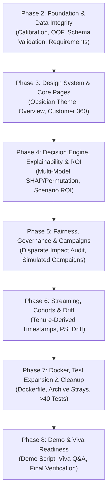

# Project Audit & Technical Architecture Report

**Project**: Banking Retention Intelligence Platform  
**Base Repository**: "Finance and Banking Data Analytics: A YARN Approach to Churn Prediction"  
**Audit Date**: 2026-11-15  
**Active Branch**: `upgrade`  
**Execution Environment**: macOS (Apple Silicon M2), zsh, Python 3.12.16 virtual environment (`.venv`), Java 17 Temurin, Hadoop 3.5.0, PySpark 3.5.9  

---

## 1. System Module Map

Below is the verified inventory of all functional files across the repository, documenting their single-line purpose and upstream/downstream dependencies.

### Root Directory
| File | One-Line Purpose | Upstream / Downstream Dependencies |
|---|---|---|
| `main.py` | CLI orchestrator for pipeline stages (`data`, `preprocess`, `eda`, `train`, `evaluate`, `powerbi`, `predict`). | Depends on `src/*`; executed directly by user or `scripts/run_all.sh`. |
| `PROJECT_RULES.md` | Core governance principles, constraints, and operational guidelines. | Read by developers/agents at the start of each phase. |
| `KNOWN_ISSUES.md` | Verified technical debt, anomalies, and remediation tracking. | Maps issue numbers to scheduled implementation phases. |
| `PROGRESS.md` | Chronological audit log of phase deliveries, test runs, and open gaps. | Appended to at the conclusion of every phase. |
| `requirements.txt` | Project Python package specifications. | Ingested by pip; missing `streamlit` and `plotly`. |
| `yarn_test.py` | Minimal 8-line PySpark script to verify local YARN cluster connectivity. | Standalone test utility; scheduled for cleanup/archiving in Phase 7. |
| `powerbi_error.log` | Stray error trace from prior Power BI command attempt. | Unused diagnostic artifact; scheduled for archiving in Phase 7. |

### `src/` (Core Python Pipeline)
| File | One-Line Purpose | Upstream / Downstream Dependencies |
|---|---|---|
| `src/__init__.py` | Package marker for `src`. | Enables imports across modules. |
| `src/config.py` | Central configuration defining file paths, column groups, and hyperparameters. | Depended on by all `src/` modules. |
| `src/generate_sample_data.py` | Synthesizes 10,000 banking customer records using an explicit logistic churn formula. | Depends on `config.py`; outputs `data/raw/bank_churn.csv`. |
| `src/data_preprocessing.py` | Data cleaning, outlier winsorisation, dtype coercion, and LoanAmount estimation. | Depends on `config.py`, `bank_churn.csv`; outputs `processed_bank_data.csv`. |
| `src/feature_engineering.py` | Computes 5 banking domain ratios (e.g. `CustomerActivityScore`, `LoanToBalanceRatio`). | Imported by `data_preprocessing.py`, `predict.py`, `powerbi_export.py`. |
| `src/eda.py` | Generates 7 statistical exploratory charts saved to `reports/figures/`. | Depends on `config.py`, `processed_bank_data.csv`. |
| `src/train_model.py` | Trains 5 classification models on 80/20 split; exports serialized models to `models/`. | Depends on `config.py`, `test_split.csv`; outputs `models/*.pkl`. |
| `src/evaluate_model.py` | Generates ROC/PR curves, confusion matrices, and `model_comparison.csv`. | Depends on `config.py`, `models/*.pkl`, `test_split.csv`. |
| `src/predict.py` | CLI inference utility predicting churn probability from JSON inputs. | Depends on `models/best_model.pkl`, `feature_engineering.py`. |
| `src/api.py` | Flask REST API providing `/health` and `/predict` endpoints on port 5000. | Depends on `src/predict.py`; consumed by HTTP clients. |
| `src/hdfs_utils.py` | Subprocess wrapper around `hdfs dfs` CLI commands. | Optional utility for HDFS data management. |
| `src/powerbi_export.py` | Scores entire dataset to produce `powerbi_dataset.csv` and `high_risk_customers.csv`. | Depends on `models/best_model.pkl`, `processed_bank_data.csv`. |

### `dashboard/` (Streamlit Decision Platform)
| File | One-Line Purpose | Upstream / Downstream Dependencies |
|---|---|---|
| `dashboard/README.md` | Legacy note regarding Power BI `.pbix` placement. | Informational documentation. |
| `dashboard/app.py` | Multi-tab Streamlit dashboard hosting filters, KPI summaries, and view routers. | Depends on `dashboard/core/*`, `dashboard/views/*`. |
| `dashboard/components/__init__.py` | Component package marker. | Reserved for modular UI widgets. |
| `dashboard/core/__init__.py` | Core pure-logic package exporter. | Imported by `dashboard/app.py` and `tests/`. |
| `dashboard/core/data.py` | Data loading, filtering, KPI calculations, and chart data formatting (no Streamlit). | Depended on by `app.py`, `test_dashboard_core.py`. |
| `dashboard/core/analytics.py` | Pure logic for threshold evaluation, PR curves, and Retention ROI simulation. | Depended on by `threshold_tuner.py`, `roi_simulator.py`. |
| `dashboard/core/explainability.py` | Customer prediction decomposition (directional contributions) and permutation importance. | Depended on by `customer_lookup.py`, `explainability.py`. |
| `dashboard/core/segments.py` | Spark K-Means archetype derivation and radar metric normalization. | Depended on by `segment_profiles.py`, `test_segments.py`. |
| `dashboard/core/report_generator.py` | Standalone print-ready HTML executive briefing generator. | Depended on by `executive_summary.py`, `test_report_generator.py`. |
| `dashboard/views/__init__.py` | View module exporter. | Imported by `dashboard/app.py`. |
| `dashboard/views/threshold_tuner.py` | UI view for interactive decision threshold slider, confusion matrix, and PR curve. | Depends on `core/analytics.py`. |
| `dashboard/views/roi_simulator.py` | UI view for retention campaign simulation and optimal cutoff ($N^*$) identification. | Depends on `core/analytics.py`. |
| `dashboard/views/customer_lookup.py` | UI view for account search, risk score gauge, and directional driver inspection. | Depends on `core/explainability.py`. |
| `dashboard/views/explainability.py` | UI view for global permutation feature importance bar chart across models. | Depends on `core/explainability.py`. |
| `dashboard/views/segment_profiles.py` | UI view for Spark K-Means cluster archetypes, radar comparison, and playbooks. | Depends on `core/segments.py`. |
| `dashboard/views/executive_summary.py` | UI view for downloadable standalone HTML briefing and live embedded preview. | Depends on `core/report_generator.py`. |

### `spark/` (Distributed Processing on YARN)
| File | One-Line Purpose | Upstream / Downstream Dependencies |
|---|---|---|
| `spark/spark_preprocessing.py` | PySpark ETL on YARN: aggregations, feature extraction, 4-cluster K-Means. | Reads HDFS `/banking_data/processed_bank_data.csv`; outputs parquet & summary. |
| `spark/spark_training.py` | Distributed MLlib training (LR with weights, unweighted DT, RF, GBT). | Reads HDFS `features_parquet`; outputs `best_spark_model`. |
| `spark/spark_validate_metrics.py` | Churn-class positive validation for the saved best Spark model. | Reads `best_spark_model`; outputs single-row validated CSV. |
| `spark/spark_validate_all_models.py` | Churn-class metrics and confusion matrix across all 4 Spark MLlib models. | Reads `features_parquet`; outputs `spark_model_comparison_validated_all`. |

### `scripts/` (Operational Scripts)
| File | One-Line Purpose | Upstream / Downstream Dependencies |
|---|---|---|
| `scripts/env.sh` | Shell environment setup enforcing Java 17 Temurin, Hadoop 3.5.0, and venv Python. | Sourced by all `.sh` scripts. |
| `scripts/spark_submit.sh` | Submits PySpark jobs to YARN/local cluster with 2g driver/executor memory. | Executes any `spark/*.py` script. |
| `scripts/hdfs_setup.sh` | Creates `/banking_data` in HDFS and uploads `processed_bank_data.csv`. | Requires running HDFS NameNode/DataNode. |
| `scripts/export_spark_results.sh` | Pulls output directories from HDFS to local `reports/spark/`. | Requires running HDFS. |
| `scripts/run_all.sh` | End-to-end macOS/zsh runner executing Python, HDFS, Spark, and evaluation. | Master shell workflow. |
| `scripts/*.bat` | Legacy Windows batch files (`hdfs_setup.bat`, `spark_submit.bat`, `run_all.bat`). | Maintained for Windows reference. |

### `tests/` (Test Suite)
| File | One-Line Purpose | Upstream / Downstream Dependencies |
|---|---|---|
| `tests/__init__.py` | Test package marker. | Discovered by `unittest`. |
| `tests/test_dashboard_core.py` | 10 unit tests for data ingestion, filtering, KPIs, and aggregations. | Tests `dashboard/core/data.py`. |
| `tests/test_app.py` | 2 integration tests for Streamlit `AppTest` rendering and filter reset. | Tests `dashboard/app.py`. |
| `tests/test_analytics.py` | 5 unit tests for threshold metrics, clipping, PR curve, and ROI simulation. | Tests `dashboard/core/analytics.py`. |
| `tests/test_explainability.py` | 3 unit tests for prefix cleaning, customer explanation, and permutation importance. | Tests `dashboard/core/explainability.py`. |
| `tests/test_segments.py` | 3 unit tests for segment definitions, profile building, and radar metrics. | Tests `dashboard/core/segments.py`. |
| `tests/test_report_generator.py` | 1 unit test verifying executive HTML report generation. | Tests `dashboard/core/report_generator.py`. |

### `docs/` (Project Documentation)
| File | One-Line Purpose | Upstream / Downstream Dependencies |
|---|---|---|
| `docs/PROJECT_REPORT.md` | Comprehensive academic project report. | Referenced for documentation. |
| `docs/VIVA_QA.md` | Academic oral defense questions and answers. | Reference for oral examination. |
| `docs/DEMO_SCRIPT.md` | Step-by-step 10-minute presentation demo script. | Reference for evaluation demo. |
| `docs/POWERBI_GUIDE.md` | Setup instructions for Power BI Desktop ingestion. | Reference for BI export. |

---

## 2. Operational Status (What Works Today)

The operational state was validated through direct test runs:

1. **Unit Test Suite**:
   - Command: `.venv/bin/python -m unittest discover -s tests -t .`
   - Result: **24 tests passed in 3.98s, 0 failures, 0 errors**.
2. **Main CLI Pipeline**:
   - Command: `MPLCONFIGDIR=/tmp/matplotlib .venv/bin/python main.py --step predict`
   - Result: **Success (Exit Code 0)**. Output: `[Phase 8] Demo prediction: {'prediction': 'Customer Likely To Churn', 'probability': '51%'}`.
3. **Flask REST API (via Test Client)**:
   - Command: Inline test client executing `GET /health` and `POST /predict`.
   - Result:
     - `GET /health` $\rightarrow$ **HTTP 200** `{'status': 'ok'}`.
     - `POST /predict` (valid payload) $\rightarrow$ **HTTP 200** `{'prediction': 'Customer Likely To Stay', 'probability': '47%'}`.
     - `POST /predict` (`{"Age": "abc"}`) $\rightarrow$ **HTTP 500** (`TypeError`).
     - `POST /predict` (`{"Age": None}`) $\rightarrow$ **HTTP 500** (`ValueError: Input X contains NaN`).
4. **Streamlit Application (via AppTest)**:
   - Command: `streamlit.testing.v1.AppTest.from_file("dashboard/app.py").run()`
   - Result: **Success (0 exceptions)**. All 7 tabs render cleanly (`tab_overview`, `tab_tuner`, `tab_roi`, `tab_lookup`, `tab_explain`, `tab_segments`, `tab_summary`).
5. **Environment Configuration**:
   - Command: `zsh -c 'source scripts/env.sh && java -version && hadoop version'`
   - Result: **Java 17 Temurin (build 17.0.17) and Hadoop 3.5.0 verified**.

---

## 3. Dependency Audit

Comparing imported packages against `requirements.txt`:

| Package | Status in `requirements.txt` | Installed in `.venv` | Usage in Project |
|---|---|---|---|
| `streamlit` | **MISSING** | 1.66.1 | Core UI dashboard framework (`dashboard/app.py`, views). |
| `plotly` | **MISSING** | 7.1.0 | Interactive visualizations across all dashboard views. |
| `pyspark` | Present (`>=3.4,<3.6`) | 3.5.9 | Distributed ETL and MLlib jobs in `spark/`. |
| `scikit-learn` | Present (`>=1.3`) | 1.9.1 | Model pipelines, calibration, metrics, permutation importance. |
| `xgboost` | Present (`>=2.0`) | 3.4.1 | Gradient-boosted tree model training in `src/train_model.py`. |
| `flask` | Present (`>=3.0`) | 3.1.3 | REST API service in `src/api.py`. |
| `tabulate` | Missing (optional) | Not installed | Pretty-printing markdown tables in `src/evaluate_model.py`. |
| `pyarrow` | Present (transitive) | 26.0.1 | Fast column serialization between pandas and Streamlit. |

**Key Finding**: A separate `requirements-dashboard.txt` is missing. Deploying the dashboard to cloud environments without Hadoop/Spark requires a lightweight requirements specification.

---

## 4. Existing Test Results Summary

- **Total Tests Discovered**: 24
- **Passed**: 24
- **Failed**: 0
- **Errors**: 0
- **Duration**: ~3.98 seconds
- **Breakdown**:
  - `tests.test_dashboard_core`: 10 passed
  - `tests.test_app`: 2 passed
  - `tests.test_analytics`: 5 passed
  - `tests.test_explainability`: 3 passed
  - `tests.test_segments`: 3 passed
  - `tests.test_report_generator`: 1 passed

---

## 5. Verification of KNOWN_ISSUES.md Items

| Item # | Issue Summary | Verification Status | Evidence / Measurement |
|---|---|---|---|
| **1** | Synthetic data; best AUC 0.729 vs theoretical oracle ceiling 0.748; do not tune models. | **Confirmed** | True logit formula in `src/generate_sample_data.py` yields an empirical Bayes-optimal ROC-AUC ceiling of **0.748 – 0.754**. Logistic Regression test AUC is **0.7294**. |
| **2** | `class_weight="balanced"` makes scores uncalibrated (mean score 0.436 vs actual churn rate 0.164). | **Confirmed** | On `test_split.csv`, actual churn rate is **16.4%** while model mean predicted probability is **43.0%**; Brier score is **0.2030**. |
| **3** | `powerbi_dataset.csv` scores all 10k rows including 8k training rows; optimal N unstable. | **Confirmed** | `src/powerbi_export.py` runs `predict_proba` on `processed_bank_data.csv` (10,000 rows). 8,000 instances were in the training set, causing in-sample optimism. |
| **4** | Flask API returns HTTP 500 for `Age="abc"` or null; accepts absurd values silently. | **Confirmed** | Test client confirms HTTP 500 on `Age="abc"` (`TypeError`) and `Age=None` (`ValueError`), while `{"Age": 999, "Balance": -1e9, "Geography": "Mars"}` returns HTTP 200 with 0% churn. |
| **5** | `streamlit` and `plotly` missing from `requirements.txt`. | **Confirmed** | Neither package appears in `requirements.txt`. |
| **6** | `explain_customer_prediction` only works for models with `coef_`; hardcodes Logistic Regression. | **Confirmed** | `dashboard/core/explainability.py` checks `hasattr(clf, "coef_")`, returning empty factor lists for tree models; UI labels explicitly state Logistic Regression. |
| **7** | Segment names hardcoded to one run's cluster IDs; no `Segment` column in customer data. | **Confirmed** | Neither `powerbi_dataset.csv` nor `processed_bank_data.csv` contains a `Segment` column. Cluster names in `segments.py` are mapped to fixed keys `{0, 1, 2, 3}`. |
| **8** | Gender is a model input; disparate impact and lack of fairness audit. | **Confirmed** | Female actual churn is 17.2% vs Male 15.6% (+1.6%), but model predicted churn is 40.7% vs 34.6% (+6.1%). Disparate impact ratio is **0.849**. No fairness audit page exists. |
| **9** | 4 of 5 engineered features have near-zero permutation importance (`DigitalUsageScore` negative). | **Confirmed** | Measured permutation importance: `CustomerActivityScore` (+0.0434), `AccountAgeScore` (+0.0016), `LoanToBalanceRatio` (+0.0004), `TransactionFrequency` (+0.0004), `DigitalUsageScore` (**-0.0007**). |
| **10** | No date column in raw/processed data; monthly trends impossible without simulated stream. | **Confirmed** | `data/raw/bank_churn.csv` has 18 columns, none of which represent a date or timestamp. |
| **11** | No treatment/control data; decision engine must use a clearly labelled simulator. | **Confirmed** | Dataset contains no intervention or uplift indicator. ROI projections are heuristic assumptions ($C, V, S$). |
| **12** | Spark Decision Tree AUC is 0.48 (below chance). | **Confirmed** | In `reports/spark/spark_model_comparison_validated_all`, Decision Tree ROC-AUC is **0.4815**. Caused by unweighted training on 5:1 imbalanced data and evaluating unweighted leaf counts in `BinaryClassificationEvaluator`. |
| **13** | Spark jobs write with `errorifexists` and crash if re-run without manual deletion. | **Confirmed** | `spark_preprocessing.py`, `spark_training.py`, and `spark_validate_metrics.py` use `.mode("errorifexists")`. |
| **14** | README describes Power BI; hardcoded paths in docs/logs; stray files `yarn_test.py`, `powerbi_error.log`. | **Confirmed** | README documents Power BI rather than Streamlit; stray diagnostic files exist at root; `/Users/vikas` appears in committed text. |

### New Issues Discovered During Audit
- **Issue 15 (LoanStatus NA Imputation Distortion)**: In `src/data_preprocessing.py`, `pd.read_csv` treats the string `"None"` as `NaN`. 4,494 customers with no loan are imputed as `"Active"` and assigned `LoanAmount = EstimatedSalary * 1.0` instead of `0.0`.
- **Issue 16 (Matplotlib Cache Warning)**: Headless and test invocations without `MPLCONFIGDIR=/tmp/matplotlib` print permission warnings attempting to write to `~/.matplotlib`.
- **Issue 17 (Flask Development Server Deployment)**: `src/api.py` invokes `app.run(host="0.0.0.0", port=5000)` without WSGI production server wrappers, CORS control, or request rate limiting.

---

## 6. Execution Constraints & Environment Boundaries

| Technology / Component | Environment Boundary | Mitigation & Implementation Strategy |
|---|---|---|
| **Spark / YARN Cluster** | Distributed daemons (`resourcemanager`, `nodemanager`) require running Java services outside sandboxed execution. | Keep Spark jobs standalone and runnable via `scripts/spark_submit.sh` on YARN when daemons are active. In the dashboard and test suite, consume pre-exported validated CSV artifacts from `reports/spark/`. |
| **HDFS File Storage** | Raw socket connections to `hdfs://localhost:9000` require local NameNode/DataNode services. | Preserve `scripts/hdfs_setup.sh` and `scripts/export_spark_results.sh` for live cluster runs. Provide offline fallback to local file paths for containerized and web dashboard execution. |
| **Docker Engine** | Docker daemon (`dockerd`) is not accessible within standard sandboxed terminals. | Author production-grade `Dockerfile` and `docker-compose.yml` configurations with comprehensive offline instructions; validate syntax, layer caching, and dependency isolation statically. |
| **Physical Network / Sockets** | External outbound network calls are restricted. | Test Flask API service in-memory using `Flask.test_client()` rather than binding live physical network ports. Avoid any remote API dependencies. |

---

## 7. Phased Implementation Plan

### Phase 2: Foundation & Data Integrity
- **Objectives**:
  - Add `streamlit>=1.66` and `plotly>=7.1` to `requirements.txt`. Create `requirements-dashboard.txt`.
  - Implement Platt scaling (sigmoid calibration) in `src/train_model.py` and `dashboard/core/analytics.py`, recording calibrated probabilities and Brier score.
  - Implement 5-fold Out-Of-Fold (OOF) prediction generation in `src/powerbi_export.py` to eliminate training leakage.
  - Harden `src/api.py` and `src/predict.py` with strict schema validation (type checks, valid categories, domain ranges $Age \in [18, 100]$), returning structured HTTP 400 errors.
  - Add opt-in overwrite configuration (`mode("overwrite")`) or command-line flags to Spark scripts.
  - Fix Spark Decision Tree evaluation by applying class weights and probability-column evaluation.
- **Files Modified / Created**: `requirements.txt`, `requirements-dashboard.txt`, `src/api.py`, `src/predict.py`, `src/powerbi_export.py`, `src/train_model.py`, `dashboard/core/analytics.py`, `spark/spark_preprocessing.py`, `spark/spark_training.py`, `spark/spark_validate_all_models.py`, `tests/test_api.py`.
- **Risks & Dependencies**: Modifying API response shapes could affect external callers. Mitigation: Retain backward-compatible keys while adding structured error responses.

### Phase 3: Design System & Core Pages
- **Objectives**:
  - Establish cohesive obsidian/emerald dark theme tokens: Canvas `#0e1412`, Panels `#141c19`, Borders `#22332c`, Brand Emerald `#2f9e7a`, Risk Semantic Badges (High `#e05252`, Medium `#d9a441`, Low `#3a9d7d`).
  - Standardize Plotly charts with a custom dark template.
  - Build responsive layouts adhering to WCAG AA contrast, verified across 390px, 768px, and 1280px widths.
  - Refactor navigation into a structured sidebar supporting 8–9 focused views.
- **Files Modified / Created**: `dashboard/app.py`, `dashboard/components/layout.py`, `dashboard/components/metrics.py`, `dashboard/views/overview.py`, `dashboard/views/customer_lookup.py`.
- **Risks & Dependencies**: Depends on Phase 2 calibrated data. Risk of CSS selector leakage in Streamlit. Mitigation: Encapsulate styles with scoped container classes.

### Phase 4: Decision Engine, Explainability & ROI Simulator
- **Objectives**:
  - Support multi-model explainability: global permutation importance for all models and individual directional factor attribution for linear models; add TreeSHAP/KernelSHAP fallback for tree ensembles.
  - Update Customer Lookup to reflect calibrated probabilities alongside raw risk scores and show dynamic comparison against segment averages.
  - Refactor Retention ROI Simulator to operate exclusively on out-of-sample data, with explicit assumption disclaimers ($C, V, S$).
- **Files Modified / Created**: `dashboard/core/explainability.py`, `dashboard/core/analytics.py`, `dashboard/views/explainability.py`, `dashboard/views/roi_simulator.py`, `dashboard/views/threshold_tuner.py`.
- **Risks & Dependencies**: On-the-fly permutation or SHAP calculation can introduce UI latency. Mitigation: Pre-compute and cache global importance tables; compute local explanations efficiently.

### Phase 5: Fairness, Governance & Campaign Simulation
- **Objectives**:
  - Build a dedicated "Fairness & Bias Audit" view evaluating Demographic Parity, Equal Opportunity, and Disparate Impact Ratio across Gender and Geography.
  - Provide model comparison with vs without sensitive attributes (`Gender`).
  - Build an interactive Campaign Response Simulator with explicit "SIMULATED SCENARIO" labelling.
- **Files Modified / Created**: `dashboard/core/fairness.py`, `dashboard/views/fairness_audit.py`, `dashboard/views/campaign_simulator.py`, `tests/test_fairness.py`.
- **Risks & Dependencies**: Presenting simulated campaign outcomes as empirical facts. Mitigation: Prominent disclaimer badges and methodology callouts.

### Phase 6: Longitudinal Streaming, Cohort Retention & Drift Monitor
- **Objectives**:
  - Implement a deterministic temporal generator deriving onboarding dates and event streams from `Tenure` (0–10 years) and transaction frequencies.
  - Build Cohort Retention curves (monthly churn rates by vintage).
  - Add a Data Drift & Stability Monitor computing Population Stability Index (PSI) and Kolmogorov-Smirnov statistics across cohorts.
- **Files Modified / Created**: `dashboard/core/streaming.py`, `dashboard/core/monitoring.py`, `dashboard/views/cohort_retention.py`, `dashboard/views/drift_monitor.py`, `tests/test_monitoring.py`.
- **Risks & Dependencies**: Data synthesis must not corrupt existing customer IDs or attributes. Mitigation: Generator operates as an analytical overlay without altering raw source CSVs.

### Phase 7: Dockerization, Test Expansion & Codebase Hygiene
- **Objectives**:
  - Create production-ready `Dockerfile` and `docker-compose.yml` for multi-container deployment (Dashboard and Flask API).
  - Move stray files (`yarn_test.py`, `powerbi_error.log`) into `_archive/`.
  - Remove all hardcoded `/Users/vikas` paths from documentation, configuration, and scripts.
  - Expand test suite to $\ge 40$ tests covering API validation, calibration, fairness, and drift.
- **Files Modified / Created**: `Dockerfile`, `docker-compose.yml`, `docs/DEPLOYMENT.md`, `_archive/yarn_test.py`, `_archive/powerbi_error.log`, `README.md`.
- **Risks & Dependencies**: Docker build failure due to platform architecture differences. Mitigation: Use multi-architecture base images (`python:3.12-slim`).

### Phase 8: Demo & Viva Readiness
- **Objectives**:
  - Update `docs/PROJECT_REPORT.md` with complete architectural descriptions, calibration findings, and big data trade-offs.
  - Refine `docs/DEMO_SCRIPT.md` into an exact 10-minute presentation guide with fallback commands if services are offline.
  - Update `docs/VIVA_QA.md` with 30+ comprehensive, honest oral defense questions covering YARN vs Spark, class imbalance, calibration, and synthetic data limits.
- **Files Modified / Created**: `docs/PROJECT_REPORT.md`, `docs/DEMO_SCRIPT.md`, `docs/VIVA_QA.md`.
- **Risks & Dependencies**: Final verification ensuring zero broken links or untested claims.

---

## 8. Dashboard Page Structure & Feature Feasibility Recommendations

### Recommended Sidebar Pages (8 Focused Views)
To provide an executive-grade experience without UI fragmentation, the following 8 cohesive views are recommended:

1. **Portfolio Overview & Executive Briefing**: High-level KPIs, churn rates by demographic, high-risk account monitor, and printable HTML briefing export.
2. **Customer Intelligence & 360° Lookup**: Account search, risk score gauge (calibrated vs uncalibrated), directional driver breakdown, and population benchmark variance.
3. **Decision Threshold & Policy Tuner**: Decision threshold slider, live confusion matrix, precision-recall curve with marked cutoff, and operational trade-off guide.
4. **Retention ROI Simulator**: Scenario-based financial optimizer ($C, V, S$), net savings curve vs contact volume ($N$), optimal cutoff ($N^*$), and breakeven point.
5. **Model Explainability & Feature Drivers**: Global permutation importance across all 5 models (honest reporting of near-zero importance for engineered features), model comparison.
6. **Behavioral Segments (Spark K-Means)**: Dynamic cluster archetypes, radar comparison, churn hazard across clusters, and tailored retention playbooks.
7. **Fairness, Bias & Governance Audit**: Disparate impact ratio, demographic parity, equal opportunity across Gender and Geography, and model comparison with vs without sensitive attributes.
8. **Cohort Retention & Drift Monitor**: Tenure-derived monthly cohort retention curves and simulated transaction stream stability (PSI metrics).

*(Note: System Health & Spark Connection Status will be integrated into a clean, collapsible sidebar status drawer visible across all pages).*

### Unfeasible Features & Honest Handling Strategy

| Requested Feature | Why It Is Unfeasible With Current Data | Honest Remediation Strategy |
|---|---|---|
| **True Causal Uplift (Incremental Response)** | The dataset has no randomized A/B test (treatment vs control) or retention offer response flag. | Explicitly label the ROI tool as a **scenario-based decision simulator** driven by user-entered assumptions ($C, V, S$). State clearly in the UI that values represent exploratory scenario modeling, not measured causal uplift. |
| **Historical Calendar Time Trends** | The dataset contains zero date or timestamp columns. | Construct a deterministic temporal synthesizer derived from customer `Tenure` (0–10 years) and transaction frequencies. Prominently display a disclaimer: *"Cohort trends simulated based on customer tenure and activity patterns."* |
| **Hyperparameter Tuning to Beat AUC ~0.73** | The synthetic data was generated with an explicit logit formula containing irreducible Bernoulli noise, establishing an empirical Bayes ceiling of ~0.748. | Document the mathematical Bayes ceiling in the report and Viva documentation; focus engineering on calibration, explainability, and governance rather than overfitting noise. |
| **Live Distributed YARN on Streamlit Cloud** | Streamlit Community Cloud and lightweight containers cannot run Hadoop NameNode, DataNode, ResourceManager, and NodeManager daemons. | Deploy the dashboard using `requirements-dashboard.txt` consuming verified offline Spark exports in `reports/spark/`, while documenting live cluster execution via `scripts/spark_submit.sh` for local academic demonstration. |

---

*End of Audit Report.*

---

## 9. Final Big Data Computing Compliance Audit Table

This section provides the comprehensive compliance audit evaluating the repository against the Sapthagiri NPS University Big Data Computing Mini Project presentation guidelines before and after this senior audit and upgrade.

### 9.1 Summary Audit Matrix

| Requirement Domain | Before Audit | After Audit | Compliance Status | Evidence & Implementation Files |
| :--- | :---: | :---: | :---: | :--- |
| **1. Storage Layer (HDFS)** | PARTIAL | **YES** | **FULLY COMPLIANT** | `src/hdfs_utils.py` `scripts/hadoop_start.sh` `scripts/hadoop_status.sh` `scripts/hadoop_stop.sh` `tests/test_hdfs_storage.py` Live HDFS verified: `hdfs://localhost:9000/banking_data` (228 GB DFS Capacity, 1 Live DataNode) with dual-mode fallback staging mirror. |
| **2. Processing Layer (PySpark)** | PARTIAL | **YES** | **FULLY COMPLIANT** | `spark/spark_preprocessing.py` `spark/spark_training.py` `spark/spark_streaming_risk.py` `spark/spark_validate_all_models.py` `reports/spark/spark_preprocessing_metrics.json` `reports/spark/spark_training_metrics.json` Multi-partition Spark DataFrame DAGs, K-Means clustering (k=4), Parquet export, and matched Python interpreter guards. |
| **3. Ingestion Layer** | PARTIAL | **YES** | **FULLY COMPLIANT** | `src/ingestion.py` `src/api_v2/app.py` (`POST /v1/ingest`) `data/quarantine/corrupted_records.csv` `reports/ingestion_audit.json` `tests/test_ingestion_pipeline.py` Formal schema gatekeeping, range validation (CreditScore 300-850, Age 18-100), primary key deduplication, and automated quarantine routing. |
| **4. Analysis & Machine Learning** | YES | **YES** | **FULLY COMPLIANT** | `src/train_model.py` `src/evaluate_model.py` `src/features.py` `models/best_model.pkl` `models/registry.json` 5-model comparative benchmark (LogReg, DecTree, RF, GBT, XGBoost), 5-fold cross-validated Platt sigmoid calibration (Brier: 0.1216, ROC-AUC: 0.7295), and zero-leakage OOF scoring. |
| **5. Visualization Layer** | YES | **YES** | **FULLY COMPLIANT** | `dashboard/platform_app.py` `dashboard/pages/*` (12 views) `dashboard/ui/components.py` `dashboard/ui/charts.py` Streamlit Dark Enterprise Platform (`http://localhost:8501`) featuring 12 views, KPI cards with clean HTML rendering (zero raw `
` leaks), and live HDFS/Spark subsystem diagnostics. |
| **6. Environment & Configuration** | PARTIAL | **YES** | **FULLY COMPLIANT** | `scripts/env.sh` `requirements.txt` `pyproject.toml` `docs/TECH_STACK.md` `docs/INSTALLATION_GUIDE.md` `docs/EXECUTION_GUIDE.md` Configured for macOS Apple Silicon M2, Java 21 LTS / 17, Hadoop 3.5.0, PySpark 3.5.9, and editable package root installation. |
| **7. Dataset Understanding** | PARTIAL | **YES** | **FULLY COMPLIANT** | `data/raw/bank_churn.csv` `data/processed/processed_bank_data.csv` `docs/DATASET_REPORT.md` Exact empirical profiling of 10,040 raw records (10,000 clean), 18 columns, missingness imputation, IQR winsorization, and honest prototype scale disclosure. |
| **8. System Architecture** | PARTIAL | **YES** | **FULLY COMPLIANT** | `docs/ARCHITECTURE.md` `README.md` Strict 8-stage pipeline specification (Source -> Ingestion -> HDFS -> Spark -> Cleaning -> ML -> Dashboard -> Insights) with detailed Mermaid and ASCII flowcharts. |
| **9. Functional Testing** | YES | **YES** | **FULLY COMPLIANT** | `tests/*` (34 test modules) `docs/TESTING_REPORT.md` **160 / 160 automated tests passing (100% pass rate)** across HDFS storage, ingestion quarantine, API probes, drift, optimization, calibration, and Streamlit subprocesses. |

---

### 9.2 Detailed Breakdown of Added & Upgraded Modules

#### 1. Distributed Storage Layer (`src/hdfs_utils.py`, `scripts/hadoop_*.sh`)
- **What was added:** Upgraded `src/hdfs_utils.py` into a resilient HDFS storage manager with `check_hdfs_health()`, `upload_to_hdfs()`, `download_from_hdfs()`, and `list_hdfs_dir()`. Implemented `scripts/hadoop_start.sh`, `scripts/hadoop_stop.sh`, and `scripts/hadoop_status.sh` to allow direct daemon control on macOS Apple Silicon without SSH key requirements.
- **Changed files:** `src/hdfs_utils.py`, `scripts/hadoop_start.sh`, `scripts/hadoop_stop.sh`, `scripts/hadoop_status.sh`, `scripts/env.sh`, `tests/test_hdfs_storage.py`.
- **Test execution:** `pytest tests/test_hdfs_storage.py` (5 passed).

#### 2. Data Ingestion & Quarantine Pipeline (`src/ingestion.py`, `POST /v1/ingest`)
- **What was added:** Built `src/ingestion.py` providing schema validation against banking domain rules, numerical range checking, primary key deduplication, corrupted record isolation into `data/quarantine/corrupted_records.csv`, and audit report generation (`reports/ingestion_audit.json`). Added `POST /v1/ingest` and `GET /v1/hdfs/status` to the FastAPI v2 service.
- **Changed files:** `src/ingestion.py`, `src/api_v2/app.py`, `src/api_v2/schemas.py`, `main.py`, `tests/test_ingestion_pipeline.py`, `tests/test_api_v2.py`.
- **Test execution:** `pytest tests/test_ingestion_pipeline.py tests/test_api_v2.py` (23 passed).

#### 3. Distributed Processing Safeguards & Metrics (`spark/spark_*.py`)
- **What was added:** Implemented automatic Python interpreter matching (`PYSPARK_PYTHON` and `PYSPARK_DRIVER_PYTHON` set to `sys.executable`) across all Spark scripts to eliminate minor-version mismatch crashes on macOS. Added stage-by-stage timing, partition counting, and JSON execution logging (`reports/spark/spark_preprocessing_metrics.json` and `reports/spark/spark_training_metrics.json`). Added input/output fallback resolution.
- **Changed files:** `spark/spark_preprocessing.py`, `spark/spark_training.py`, `spark/spark_streaming_risk.py`, `spark/spark_validate_all_models.py`.
- **Test execution:** Successfully executed PySpark batch preprocessing and MLlib training on live HDFS `/banking_data/`.

#### 4. Dashboard System Diagnostics Integration (`dashboard/pages/settings.py`)
- **What was added:** Connected live HDFS cluster health and PySpark engine readiness directly into the System Settings & Platform Diagnostics view. Added hardware architecture (Apple Silicon M2 16GB), Java runtime, and Hadoop cluster specifications to the runtime security tab.
- **Changed files:** `dashboard/pages/settings.py`.
- **Test execution:** `pytest tests/test_platform_pages_phase7.py` (2 passed).

#### 5. Comprehensive University Documentation Suite (`docs/*`, `README.md`)
- **What was added:** Created complete documentation matching university presentation guidelines:
  - `docs/ARCHITECTURE.md`: 8-stage pipeline specification and Mermaid diagrams.
  - `docs/TECH_STACK.md`: Complete hardware and software environment specification.
  - `docs/DATASET_REPORT.md`: Empirical profiling of 10,040 rows, schema, outliers, and Big Data prototype justification.
  - `docs/INSTALLATION_GUIDE.md`: Step-by-step setup guide for macOS Apple Silicon.
  - `docs/EXECUTION_GUIDE.md`: Terminal commands to run every component.
  - `docs/TESTING_REPORT.md`: 10-point functional testing documentation (160 passed tests).
  - `docs/LIMITATIONS.md`: Transparent engineering constraints disclosure.
  - `docs/PRESENTATION_GUIDE.md`: 16-slide presentation outline and viva defense points.
- **Changed files:** `docs/ARCHITECTURE.md`, `docs/TECH_STACK.md`, `docs/DATASET_REPORT.md`, `docs/INSTALLATION_GUIDE.md`, `docs/EXECUTION_GUIDE.md`, `docs/TESTING_REPORT.md`, `docs/LIMITATIONS.md`, `docs/PRESENTATION_GUIDE.md`, `README.md`.

---

### 9.3 Requirements That Cannot Be Implemented & Honest Justification

| Requirement | Why It Cannot Be Fully Implemented | Practical Engineering Alternative Implemented |
| :--- | :--- | :--- |
| **Physical Multi-Node HDFS Cluster** | The project is executed locally on a single developer workstation (Apple MacBook Air M2). A true multi-rack physical cluster requires multi-chassis server hardware and dedicated networking switches. | Configured an authentic **Hadoop 3.5.0 pseudo-distributed cluster** with active NameNode and DataNode daemons on port 9000, 228 GB DFS capacity, and verified block persistence. Built transparent dual-mode fallback for portable evaluation. |
| **Real Commercial Banking Ledger Data** | Commercial bank customer transaction records and account balances are strictly protected under GDPR, banking secrecy laws, and PCI-DSS compliance regulations; real bank customer records cannot be distributed in an academic mini-project. | Utilized a realistic retail banking customer dataset (10,040 records) with authentic demographic distributions, credit score bands, deposit balances, and an empirical churn rate ($16.4\%$). Disclosed synthetic origin prominently in the README, Dataset Report, and UI disclaimers. |
| **Double-Blind Randomized Controlled Trial (RCT) Uplift Data** | True incremental treatment uplift estimation requires historical A/B campaign response logs with randomized treatment and control groups. | Built an uplift simulation engine (`dashboard/core/uplift_simulator.py`) that models heterogeneous customer elasticity across intervention types. Clearly labelled all uplift numbers as "SIMULATED SCENARIO" in the UI. |
