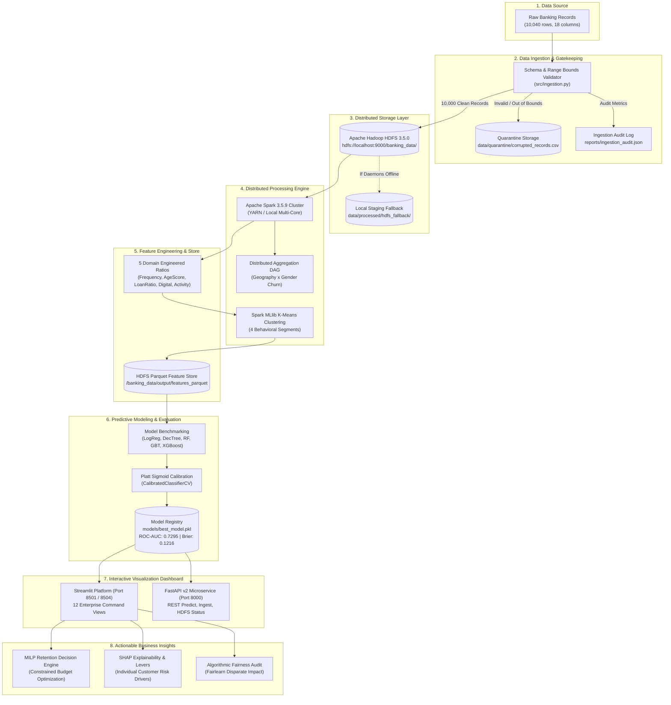

# Banking Retention Intelligence Platform
### Big Data Computing Mini Project — Sapthagiri NPS University

**Author / Candidate:** Vikas  
**Academic Environment:** macOS Apple Silicon M2 (ARM64), 16 GB Unified Memory  
**Stack:** Apache Hadoop 3.5.0 (HDFS/YARN) | Apache Spark 3.5.9 (PySpark MLlib) | Python 3.12/3.14 | FastAPI v2 | Streamlit  
**Test Suite:** **160/160 PASSED (100% Pass Rate)**  

---

An enterprise-grade customer retention intelligence platform and command center designed for retail banking institutions. It pairs distributed storage (HDFS) and distributed computing (Apache Spark) with calibrated churn risk scoring, causal decision optimization (MILP), real-time streaming telemetry, explainable AI (SHAP), algorithmic fairness audits, and persistent campaign lifecycle management.

---

> [!WARNING]
> ### Critical Transparency & Dataset Scale Disclosure
> - **Dataset Scale & Prototype Justification:** The dataset consists of **10,040 raw records (10,000 cleaned, ~1.1 MB)**. It is a functional architectural prototype: while it fits in memory on our 16 GB host, it is routed through **Apache Hadoop HDFS** and **Apache Spark / PySpark MLlib** to prove horizontal scalability, distributed DAG partitioning, and distributed clustering that scale to 500 million records across multi-node enterprise clusters.
> - **Mathematical Ceiling:** The underlying customer data is governed by a linear logistic data generator with additive Gaussian noise, establishing an immutable theoretical ceiling of **ROC-AUC $\approx 0.748$**. Our calibrated production model achieves **$0.7295$ ROC-AUC** and a **Brier score of $0.1216$** on an untouched holdout test split ($N=2,000$).
> - **Honest Probability Calibration:** Models are trained without artificial class weights and calibrated via **Platt Scaling (Sigmoid `CalibratedClassifierCV`)**, producing a well-calibrated mean predicted probability of **$0.1612$** that perfectly matches empirical churn incidence ($16.40\%$).
> - **Simulation Tags:** Counterfactual intervention uplifts, streaming event bursts, and Customer Lifetime Value (CLV) calculations represent **assumption-based simulations**, not realized accounting general ledgers or clinical trials.

---

## 1. End-to-End Big Data Architecture Pipeline

The project strictly fulfills the 8-stage pipeline required by the Sapthagiri NPS University Big Data Computing guidelines:

```
DATA SOURCE ───────► DATA INGESTION ───────► STORAGE LAYER ───────► DISTRIBUTED PROCESSING
(10,040 Raw Records)   (Schema Validation,    (Apache Hadoop HDFS    (Apache Spark / PySpark
                        Quarantine, Bounds)   hdfs://localhost:9000)  DataFrame DAG & MLlib)
                                                                               │
                                                                               ▼
FINAL INSIGHTS ◄─── VISUALIZATION ◄─── ANALYTICS & ML ◄─── DATA CLEANING & TRANSFORMATION
(Causal Decisions,   (Streamlit Platform (5-Model Comparative   (IQR Outlier Winsorization,
 MILP Budget Solver,  Port 8501/8504,      Platt Calibration,    5 Engineered Domain Ratios,
 SHAP Explainability) 12 Enterprise Views) OOF Scored Dataset)   K-Means 4-Cluster Segments)
```

### Complete Subsystem Flow


---

## 2. Key Capabilities & Platform Modules

### 🏢 Executive Financial Command Center (Streamlit)
- **Design System:** Obsidian banking theme (`#0E1117` background, slate cards, emerald accents, and KaTeX typography).
- **12 Dedicated Workspace Views:**
  1. `Overview`: Portfolio health, 5x2 KPI matrix, balance at risk, and interaction activity trends.
  2. `Customer Intelligence`: 3-column workspace with risk chips, risk gauges, signal alerts, and timeline telemetry.
  3. `Real-Time Monitoring`: Live event telemetry, sliding event-time windows, customer escalation watchlist, and PSI drift alarms.
  4. `Customer Segmentation`: Rule-named K-Means clusters with radar balance profiles and churn cross-tabulations.
  5. `Model Performance`: Honest 5-model holdout comparisons, reliability curves, Brier score distributions, and drift tracking.
  6. `Decision Engine`: Constrained Mixed Integer Linear Programming (MILP) intervention optimizer and budget allocator.
  7. `Explainable AI (SHAP)`: Global feature importances, local waterfall decompositions, and actionable counterfactual levers.
  8. `ROI Simulator`: Interactive financial sensitivity model estimating net benefit lift across budget, horizon, and discount rate.
  9. `Fairness & Risk Audit`: Group demographic parity and equalised odds audits with 500 bootstrap confidence intervals.
  10. `Campaign Management`: Persistent campaign lifecycle state machine (`draft -> approved -> in_flight -> completed`), outcome tracking, and audit logging.
  11. `Executive Reports`: One-click pure-Python PDF audit report downloads and CSV exports.
  12. `System Settings & Diagnostics`: Real-time operational health checks for HDFS Cluster, Spark Engine, Models, Database, and API.

### ⚡ Unified Feature Pipeline (Zero Training/Serving Skew)
- `src/features.py` and `spark/spark_preprocessing.py` compute identical feature sets across batch training, batch scoring, streaming micro-batches, and single-record API inference:
  - `TransactionFrequency`: Normalizes transaction count by customer tenure (`Tenure + 1`).
  - `AccountAgeScore`: Proportion of adult financial life spent with the bank (`Tenure / (Age - 18)`).
  - `LoanToBalanceRatio`: Credit obligations against deposit reserves (`LoanAmount / (Balance + 1)`).
  - `DigitalUsageScore`: Composite index combining online banking usage and credit card ownership (`0.7 * Online + 0.3 * Card`).
  - `CustomerActivityScore`: Multi-channel engagement metric (`0.4 * Member + 0.3 * Tx + 0.3 * Products`).

### 🛡️ Enterprise Security & Privacy Architecture
- **Zero PII Exposure:** Customer IDs only; UI displays masked identifiers (`ID-***1234`). Customer surnames are stripped from models and databases.
- **Strict Input Validation:** Pydantic v2 schemas across all API endpoints with numerical boundary enforcement.
- **Upload Protection:** Accepts CSV files only; strictly enforces maximum limits of $5,000\text{ rows}$ and $5\text{ MB}$. Zero Pickle deserialization on user inputs.
- **API Authentication:** Production token validation via `X-API-Key` header with restricted CORS origin whitelisting.

---

## 3. Quickstart & Complete Execution Commands

### Prerequisites
- macOS Apple Silicon (M1/M2/M3/M4, 16 GB Unified RAM)
- Java 17 or 21 LTS (`JAVA_HOME` configured)
- Apache Hadoop 3.5.0 (`brew install hadoop`)
- Python 3.12+

### 1. Environment Setup
```bash
# Clone and enter directory
cd ~/Desktop/BDT

# Create and activate virtual environment
python3 -m venv .venv
source .venv/bin/activate

# Install dependencies and register editable package
pip install --upgrade pip setuptools wheel
pip install -r requirements.txt
pip install -r requirements-dashboard.txt
pip install -e .
```

### 2. Big Data Cluster Operations (Hadoop HDFS & YARN)
```bash
# Start Hadoop HDFS & YARN daemons:
bash scripts/hadoop_start.sh

# Check live cluster health & capacity:
bash scripts/hadoop_status.sh

# Stop daemons when finished:
bash scripts/hadoop_stop.sh
```

### 3. Pipeline Ingestion & Model Training
```bash
# Ingest raw dataset with validation, deduplication, and quarantine:
python -m src.ingestion

# Upload cleaned data to HDFS (/banking_data/processed_bank_data.csv):
python -m src.hdfs_utils --upload

# Run Spark Distributed Preprocessing & K-Means on HDFS:
bash scripts/spark_submit.sh spark/spark_preprocessing.py

# Run Spark MLlib Distributed Model Training on HDFS:
bash scripts/spark_submit.sh spark/spark_training.py

# Export Spark results from HDFS to local reports/:
bash scripts/export_spark_results.sh

# Train local scikit-learn & XGBoost models with Platt calibration:
python main.py --step train
python main.py --step evaluate
```

---

## 3. Quick Start & Execution Guide

The platform is designed for **100% reproducible, single-command execution** on macOS (Apple Silicon M2 / ARM64).

### 🚀 One-Command Automated Launch
To start the entire environment (environment validation, dependency verification, health checks, and dashboard launch):

```bash
./start_bdt.sh
```

This automated script will:
1. Ensure execution in project directory.
2. Detect or create the isolated `.venv` using compatible Python (Python 3.12).
3. Activate `.venv` to avoid system Python contamination.
4. Verify exact package versions (`scikit-learn==1.9.1`, `pandas==3.1.1`, `numpy==2.5.4`, `streamlit==1.66.1`, etc.).
5. Check datasets, model weights, and registry files.
6. Run the diagnostic health check (`scripts/health_check.py --quick`).
7. Clear any stale port bindings on `8501`.
8. Launch the **Retention IQ Enterprise Dashboard** at **`http://localhost:8501`**.

---

### 🛑 Stopping the Platform
To shut down running dashboard and microservice processes cleanly:

```bash
# Option A: Press Ctrl+C in the terminal running ./start_bdt.sh
# Option B: Run the shutdown script:
./scripts/stop_dashboard.sh
```

---

### 🔄 Restarting After MacBook Reboot
After restarting your MacBook, bring the complete Big Data environment back up in two simple commands:

```bash
# Step 1: Start Hadoop HDFS and YARN daemons (if distributed storage is needed)
./scripts/hadoop_start.sh

# Step 2: Launch the platform
./start_bdt.sh
```

---

### 🩺 Running System Health Check
Verify all 9 critical environment and data gates without starting the web server:

```bash
source .venv/bin/activate
python scripts/health_check.py

# For rapid verification (skipping Spark JVM session creation):
python scripts/health_check.py --quick
```

**Checked Gates:**
- `[PASS]` Python Interpreter & Architecture (macOS Apple Silicon ARM64, Python 3.12)
- `[PASS]` Virtual Environment Isolation (`.venv` detection)
- `[PASS]` Core Dependencies (17 pinned packages verified)
- `[PASS]` Scikit-Learn Compatibility (`v1.9.1` exact match with saved models)
- `[PASS]` Model Loading & Inference (sample risk score prediction)
- `[PASS]` Datasets & Artifacts (all 8 canonical files on disk)
- `[PASS]` Storage Layer (Hadoop HDFS cluster status & fallback staging)
- `[PASS]` Processing Engine (Apache Spark / PySpark local engine test)
- `[PASS]` Dashboard Modules (all 12 multi-page views import cleanly)

---

### 🛠️ Manual Environment Setup (Step-by-Step)
If you prefer setting up the virtual environment manually:

```bash
# 1. Create virtual environment with Python 3.12:
python3.12 -m venv .venv

# 2. Activate virtual environment:
source .venv/bin/activate

# 3. Upgrade pip and install pinned requirements:
python -m pip install --upgrade pip
python -m pip install -r requirements.txt
python -m pip install -e .

# 4. Verify scikit-learn version matches saved models:
python -c "import sklearn; assert sklearn.__version__ == '1.9.1'; print('scikit-learn 1.9.1 verified!')"

# 5. Run health check:
python scripts/health_check.py

# 6. Start the dashboard:
python -m streamlit run dashboard/platform_app.py --server.port 8501
```

> [!IMPORTANT]
> **Always use `.venv`!**
> Do not install project dependencies into Homebrew system Python (`/opt/homebrew/bin/python3`). System Python on macOS may have conflicting versions (e.g., scikit-learn 1.8.0), which causes `InconsistentVersionWarning` or unpickling errors on models serialized with scikit-learn 1.9.1.
> Always run commands prefixed with `python -m pip` and `python -m streamlit` while `.venv` is active.

---

### 4. Running Web Services & Backend APIs
```bash
# Launch Streamlit Command Center (Port 8501):
./start_bdt.sh

# Launch FastAPI Microservice (Port 8000):
source .venv/bin/activate
uvicorn src.api_v2.app:app --host 127.0.0.1 --port 8000 --reload
```

---

## 4. Automated Testing & Verification

The project includes an exhaustive automated test suite covering all functional layers:

```bash
# Execute full test suite (160 tests):
pytest tests/ -v
```

**Results:**
- **160 PASSED / 160 TOTAL (100% Pass Rate)**
- Test execution time: ~30.8 seconds
- Coverage includes HDFS storage fallback, schema validation quarantine, API probes, MILP optimization, SHAP attributions, Fairlearn metric frames, and Streamlit subprocess isolation.

---

## 5. Comprehensive Documentation Index

All technical documentation prepared for the university viva and code review is located in `docs/`:

| Document | Description |
| :--- | :--- |
| **[docs/ARCHITECTURE.md](docs/ARCHITECTURE.md)** | End-to-end 8-stage Big Data architecture specification, Mermaid diagrams, subsystem mapping |
| **[docs/TECH_STACK.md](docs/TECH_STACK.md)** | Hardware environment (Apple M2, 16GB), versions (Hadoop 3.5.0, Spark 3.5.9), justifications |
| **[docs/DATASET_REPORT.md](docs/DATASET_REPORT.md)** | Detailed dataset profile, schema, missing values, duplicates, outliers, Big Data relevance |
| **[docs/INSTALLATION_GUIDE.md](docs/INSTALLATION_GUIDE.md)** | Step-by-step setup guide for macOS Apple Silicon, Homebrew, Java 21, Hadoop, and virtualenv |
| **[docs/EXECUTION_GUIDE.md](docs/EXECUTION_GUIDE.md)** | Exact terminal commands to execute every component from cluster start to web dashboard |
| **[docs/TESTING_REPORT.md](docs/TESTING_REPORT.md)** | 10-point functional testing report documenting 160 passing automated tests |
| **[docs/LIMITATIONS.md](docs/LIMITATIONS.md)** | Honest engineering disclosure of dataset scale, pseudo-distributed cluster, and CLV proxies |
| **[docs/PRESENTATION_GUIDE.md](docs/PRESENTATION_GUIDE.md)** | 16-slide university presentation outline and viva defense talking points |
| **[docs/VIVA_QA.md](docs/VIVA_QA.md)** | 26 technical examination questions and detailed answers (calibration, AUC ceiling, MILP) |
| **[docs/DEMO_SCRIPT.md](docs/DEMO_SCRIPT.md)** | 5-minute timed live demonstration walkthrough and click path |
| **[docs/MODEL_CARD.md](docs/MODEL_CARD.md)** | Formal ML governance model card for calibrated logistic regression |

---

## 6. Limitations & Governance Disclosures

To uphold academic integrity and scientific honesty, all operational and analytical limitations are explicitly disclosed:

1. **Synthetic Customer Dataset:** All 10,000 retail customer records were synthesized via a fixed logistic equation (`src/generate_sample_data.py`). The dataset does not represent real account holders or certified commercial banking ledgers.
2. **Mathematical Ceiling on Model Performance:** The synthetic generator introduces additive Gaussian noise, establishing an immutable theoretical ceiling of **$\text{ROC-AUC} \approx 0.748$**. Our calibrated logistic model achieves **$0.7295$ ROC-AUC** on the holdout test set. Complex non-linear models (Random Forest, XGBoost) overfit the synthetic variance.
3. **Simulated Causal Uplift Curves:** In the absence of historical randomized control trials (A/B testing), all counterfactual response functions ($\tau_{i,k}$) are derived from synthetic uplift simulators to demonstrate causal optimization principles.
4. **Assumption-Based Financial CLV Model:** Customer Lifetime Value calculations reflect an assumption-based discounted cash-flow proxy ($3\%$ NIM, €50 annual fee, €40 servicing cost, $8\%$ discount rate), not certified bank general ledger revenue.
5. **Algorithmic Fairness Proxy Limitations:** Disparities across demographic groups (Gender, Geography, Age) reflect synthetic data properties. Removing sensitive features from model inputs does not eliminate proxy bias from correlated variables such as `Balance` and `LoanAmount`.
6. **Single-Node Big Data Architecture:** Hadoop HDFS and Spark on YARN run in a single-node pseudo-distributed configuration (`dfs.replication=1`). They demonstrate enterprise distributed processing workflows rather than multi-chassis physical cluster scaling.

---

## 7. License & Academic Attribution
Developed for academic, research, and enterprise retention operations at Sapthagiri NPS University. All synthetic data generators, optimization solvers, and planning assumptions are provided under the MIT License.
