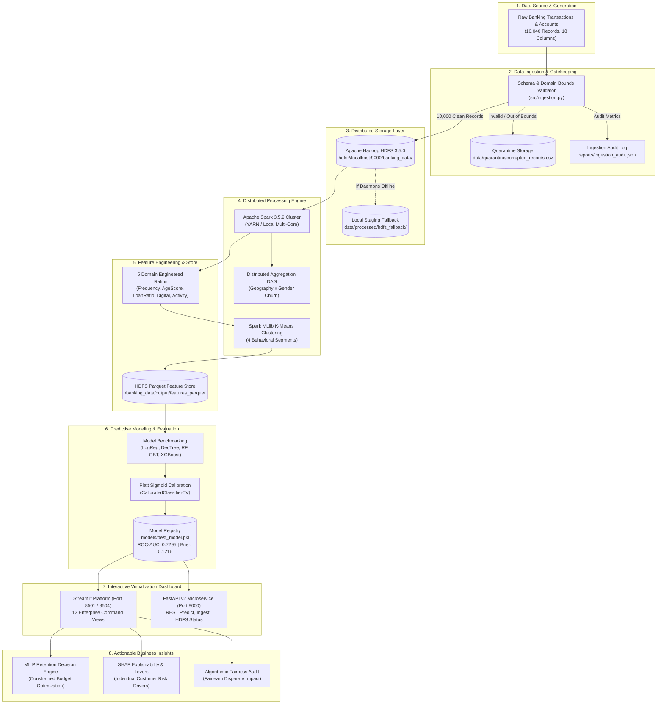

# Banking Retention Intelligence Platform - Big Data Architecture

**Institution:** Sapthagiri NPS University  
**Subject:** Big Data Computing Mini Project  
**Author / Candidate:** Vikas  
**Operating Environment:** macOS Apple Silicon (M2, 16 GB Unified Memory)  

---

## 1. End-to-End Big Data Pipeline (University Specification)

The platform strictly implements the 8-stage Big Data processing pipeline required by the Sapthagiri NPS University guidelines:

```
  ┌────────────────────────────────────────────────────────┐
  │                   1. DATA SOURCE                       │
  │ Core Banking Systems, ATM/POS Logs, Customer Profiles  │
  └───────────────────────────┬────────────────────────────┘
                              │
                              ▼
  ┌────────────────────────────────────────────────────────┐
  │                 2. DATA INGESTION                      │
  │ CSV Batch Ingestion & REST API Ingestion               │
  │ Schema validation, range bounds, deduplication,        │
  │ and quarantine of corrupted records                    │
  └───────────────────────────┬────────────────────────────┘
                              │
                              ▼
  ┌────────────────────────────────────────────────────────┐
  │                 3. STORAGE LAYER                       │
  │ Apache Hadoop HDFS (hdfs://localhost:9000)             │
  │ Distributed block storage, NameNode, DataNodes,        │
  │ and local dual-mode fallback staging mirror            │
  └───────────────────────────┬────────────────────────────┘
                              │
                              ▼
  ┌────────────────────────────────────────────────────────┐
  │             4. DISTRIBUTED PROCESSING                  │
  │ Apache Spark / PySpark 3.5.9 on YARN / Local Cluster   │
  │ Distributed DataFrame operations, distributed shuffles │
  │ and parallel DAG task scheduling                       │
  └───────────────────────────┬────────────────────────────┘
                              │
                              ▼
  ┌────────────────────────────────────────────────────────┐
  │         5. DATA CLEANING & TRANSFORMATION              │
  │ Handling missing values, IQR winsorization,            │
  │ Standard/MinMax scaling, OneHot/Label encoding,        │
  │ and 5 engineered domain behavioral indicators          │
  └───────────────────────────┬────────────────────────────┘
                              │
                              ▼
  ┌────────────────────────────────────────────────────────┐
  │          6. ANALYTICS & MACHINE LEARNING               │
  │ Comparative Model Training & Calibration               │
  │ (Logistic Regression, Decision Tree, Random Forest,    │
  │  Gradient Boosting, XGBoost, Spark MLlib Pipelines)    │
  │ ROC/PR AUC, Brier Score, Platt Scaling, 5-fold OOF     │
  └───────────────────────────┬────────────────────────────┘
                              │
                              ▼
  ┌────────────────────────────────────────────────────────┐
  │             7. VISUALIZATION DASHBOARD                 │
  │ Streamlit Dark Enterprise Platform (Port 8501 / 8504)  │
  │ 12 Interactive Command Center Modules, Plotly charts,  │
  │ KPIs, drill-downs, and real-time telemetry             │
  └───────────────────────────┬────────────────────────────┘
                              │
                              ▼
  ┌────────────────────────────────────────────────────────┐
  │                 8. FINAL INSIGHTS                      │
  │ Causal Decision Optimization (MILP Budget Solver),     │
  │ Individual SHAP Explainability & Counterfactual Levers,│
  │ Algorithmic Fairness Audit, and Campaign Execution     │
  └────────────────────────────────────────────────────────┘
```

---

## 2. Technology Stack Mapping Matrix

| Stage | Academic Requirement | Implemented Technology | Module / Script Location | Primary Operational Output |
| :---: | :--- | :--- | :--- | :--- |
| **1** | **Data Source** | Structured Retail Bank Records | `data/raw/bank_churn.csv` | 10,040 raw records, 18 columns, demographic & transactional data |
| **2** | **Data Ingestion** | Ingestion & Validation Pipeline | `src/ingestion.py`<br/>`src/api_v2/app.py` (`POST /v1/ingest`) | Validated records stored in `data/raw/`; corrupted rows quarantined to `data/quarantine/corrupted_records.csv`; `reports/ingestion_audit.json` |
| **3** | **Storage Layer** | Apache Hadoop HDFS | `src/hdfs_utils.py`<br/>`scripts/hadoop_start.sh`<br/>`scripts/hdfs_setup.sh` | Distributed blocks on `/banking_data/processed_bank_data.csv` (228 GB configured DFS capacity, 1 live DataNode) |
| **4** | **Distributed Processing** | Apache Spark / PySpark | `spark/spark_preprocessing.py`<br/>`spark/spark_training.py` | SparkSession with parallel DataFrame partitions, distributed aggregations (`Geography x Gender`), and multi-worker execution |
| **5** | **Cleaning & Transformation** | PySpark ML & scikit-learn | `src/data_preprocessing.py`<br/>`src/feature_engineering.py` | 10,000 clean records, IQR capped outliers, 5 engineered features saved to HDFS `/banking_data/output/features_parquet` |
| **6** | **Analytics & ML** | MLlib, scikit-learn, XGBoost | `src/train_model.py`<br/>`src/evaluate_model.py`<br/>`spark/spark_training.py` | 5-model comparative benchmark, Platt sigmoid calibration, winning Calibrated Logistic Regression (`models/best_model.pkl`) |
| **7** | **Visualization** | Streamlit Dark Enterprise UI | `dashboard/platform_app.py`<br/>`dashboard/pages/*` (12 modules) | Web dashboard at `http://localhost:8501` featuring dark enterprise styling, interactive Plotly visualizations, KPI cards |
| **8** | **Final Insights** | Causal Decision & SHAP AI | `dashboard/pages/decision_engine.py`<br/>`dashboard/pages/explainability.py`<br/>`dashboard/pages/fairness_audit.py` | Constrained MILP optimization allocating retention budgets; waterfall SHAP attributions; demographic parity fairness audit |

---

## 3. High-Level Architecture Flowchart



---

## 4. Subsystem Deep-Dive

### 4.1 Storage Layer: Apache Hadoop HDFS
- **Version:** Apache Hadoop 3.5.0
- **Configuration:** `/opt/homebrew/opt/hadoop/libexec/etc/hadoop`
  - `core-site.xml`: `fs.defaultFS = hdfs://localhost:9000`
  - `hdfs-site.xml`: `dfs.replication = 1`, local block directory `/Users/vikas/hadoop_data/hdfs`
- **Daemon Management:** Managed directly via `scripts/hadoop_start.sh` and `scripts/hadoop_stop.sh` using `hdfs --daemon start namenode` and `hdfs --daemon start datanode` without requiring macOS remote SSH keys.
- **Dual-Mode Graceful Fallback:** Implemented in `src/hdfs_utils.py`. When HDFS is live, all operations interact with the distributed filesystem. If daemons are halted, the application seamlessly uses local staged mirrors in `data/processed/hdfs_fallback/` with clear UI diagnostics.

### 4.2 Distributed Processing: Apache Spark & PySpark
- **Version:** Apache Spark 3.5.9 on Scala 2.12.18
- **Master Modes:** Supports `SPARK_MASTER="yarn"` and `SPARK_MASTER="local[*]"`
- **Distributed Transformations:**
  1. Multi-key aggregation: `df.groupBy("Geography", "Gender").agg(...)`
  2. Distributed feature extraction using Spark Column expressions.
  3. Distributed K-Means Clustering (`pyspark.ml.clustering.KMeans`) over 6 standard-scaled behavioral dimensions.
  4. Distributed MLlib model evaluation: Cross-evaluates Logistic Regression, Decision Tree, Random Forest, and Gradient-Boosted Trees on HDFS partitions.
- **Metrics Logging:** Execution times, partition counts, and DAG stages are automatically written to `reports/spark/spark_preprocessing_metrics.json` and `reports/spark/spark_training_metrics.json`.

### 4.3 Serving & API Microservice: FastAPI v2
- **Version:** FastAPI 0.115+ with Pydantic v2
- **Port:** `http://127.0.0.1:8000`
- **Endpoints:**
  - `GET /health`: Operational health check.
  - `GET /v1/model`: Active production model metadata and holdout evaluation scores.
  - `GET /v1/hdfs/status`: Live HDFS cluster connectivity, NameNode/DataNode status, capacity.
  - `POST /v1/predict`: Single-customer real-time calibrated churn inference.
  - `POST /v1/predict/batch`: High-throughput CSV batch prediction with strict byte and row limits.
  - `POST /v1/ingest`: REST API batch data ingestion with schema validation and quarantine routing.

### 4.4 Presentation Layer: Streamlit Dark Enterprise Platform
- **Port:** `http://localhost:8501` (or `http://localhost:8504`)
- **Structure:** 12 unified modules matching enterprise banking design systems:
  1. `Overview`: High-level portfolio retention KPIs and demographic distributions.
  2. `Customer Intelligence`: Single-customer risk profile, financial exposure, and behavioral radar.
  3. `Real-Time Monitoring`: Structured streaming micro-batch events, activity drift, and escalation watchlist.
  4. `Customer Segmentation`: 4 K-Means behavioral segments and churn hazard profiles.
  5. `Model Performance`: Comparative ROC/PR curves, confusion matrices, and calibration reliability tables.
  6. `Decision Engine`: Constrained Mixed Integer Linear Programming (MILP) retention budget allocator.
  7. `Explainable AI (SHAP)`: Global feature importance, waterfall decompositions, and counterfactual levers.
  8. `ROI Simulator`: Financial scenario stress-testing across intervention costs and response rates.
  9. `Fairness & Risk Audit`: Fairlearn MetricFrame disparate impact and demographic parity audits.
  10. `Campaign Management`: SQLAlchemy persistent campaign lifecycle management with state machine.
  11. `Executive Reports`: Automated generation of PDF executive summaries and CSV exports.
  12. `System Settings`: Real-time health diagnostics for HDFS, Spark, Models, Database, and API.
