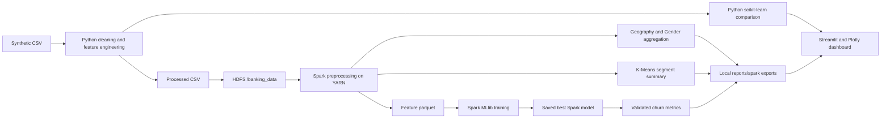

# Finance and Banking Data Analytics: A YARN Approach to Churn Prediction

## Abstract

This project demonstrates customer churn analysis with Python, Hadoop HDFS, YARN, Apache Spark MLlib, scikit-learn, and Streamlit. The bundled records are synthetic, not real bank data. The cleaned local dataset has 10,000 rows. The Python track compares five classifiers; the Spark track performs aggregation, K-Means segmentation, and MLlib classification on a single-node pseudo-distributed cluster. A separate validator computes churn-class metrics for the saved best Spark model. The two tracks are shown separately because their models and evaluation samples differ.

## Introduction

Churn analytics estimates which customers may leave so that an organization can prioritize retention analysis. This demonstration follows a data workflow from cleaning and feature engineering through distributed storage and computation to dashboard reporting. Its synthetic results illustrate the pipeline, not the behavior of real customers.

## Problem Statement

The project demonstrates how customer data can be prepared, analyzed, and used to train churn classifiers in both a local Python workflow and a Spark-on-YARN workflow. Since churn is a minority class, the evaluation must report churn-class metrics instead of relying on accuracy or weighted recall alone.

## Objectives

- Clean the synthetic customer records and engineer useful model features.
- Store processed data and Spark outputs in HDFS.
- Run Spark processing and MLlib work through YARN.
- Compare Python classifiers and validate churn-class performance for the saved Spark model.
- Display source-backed results and CSV downloads in a dashboard.
- Prevent accidental replacement of existing HDFS results.

## Existing and Proposed System

An ordinary local workflow can clean CSV data and train a model but does not demonstrate distributed storage or resource scheduling. The proposed system retains the Python workflow and adds HDFS storage, YARN scheduling, Spark preprocessing, K-Means segmentation, and Spark MLlib as a separate track. Streamlit combines selected outputs for viewing without combining the two models' metrics.

## Architecture

The cluster is single-node and pseudo-distributed. The observed YARN node listing reported one RUNNING NodeManager; this is not a multi-host production cluster.

## Technologies

| Component | Verified environment |
|---|---|
| Operating system | macOS 15.6, Apple Silicon (`aarch64`) as reported by Spark |
| Python | 3.12.16 |
| Hadoop | 3.5.0 |
| Java used for Spark validation | OpenJDK 17.0.21 |
| Apache Spark / PySpark | 3.5.9 |
| pandas | 3.1.1 |
| Streamlit | 1.66.1 |
| Plotly | 7.1.0 |
| YARN | 1 RUNNING NodeManager |

## Dataset

`data/raw/bank_churn.csv` contains 10,040 synthetic rows and 18 columns. Its generator injects duplicate rows, missing values, and extreme balance values for cleaning demonstrations. `data/processed/processed_bank_data.csv` contains 10,000 cleaned rows and 18 columns. The target is `Exited`, where 1 means churn and 0 means retained. The processed customer dataset contains 1,642 churned rows (16.42%). The data is produced by `src/generate_sample_data.py`; it is not real bank data and its metrics are illustrative.

## Preprocessing

`src/data_preprocessing.py` fixes data types, removes duplicate rows and duplicate customer IDs, drops rows without a target, fills numeric missing values with medians and categorical missing values with modes, and caps configured outliers using 1.5-IQR bounds. It writes the cleaned CSV and a separate demonstration encoding/scaling export. Python model preprocessing uses a scikit-learn pipeline fitted on the training partition only; binary fields pass through, numeric fields are standardized, and categorical fields are one-hot encoded.

## Feature Engineering

`src/feature_engineering.py` and `spark/spark_preprocessing.py` implement matching formulas:

- `TransactionFrequency = TransactionCount / (Tenure + 1)`.
- `AccountAgeScore = Tenure / max(Age - 18, 1)`, capped at 1.
- `LoanToBalanceRatio = LoanAmount / (Balance + 1)`, capped at 50.
- `DigitalUsageScore = 0.7 * min(OnlineBankingUsage / 100, 1) + 0.3 * HasCrCard`.
- `CustomerActivityScore = 0.4 * IsActiveMember + 0.3 * min(TransactionCount / 50, 1) + 0.3 * min(NumOfProducts / 4, 1)`.

`LoanAmount` exists in the bundled data. The preprocessing code estimates it only if an input omits the column; an estimate should not be treated as an observed loan amount.

## Hadoop and HDFS

The cleaned input is stored at `/banking_data/processed_bank_data.csv`; Spark data and results are under `/banking_data/output`. The HDFS wrapper uses argument-list subprocess execution on macOS and skips upload if the input already exists. Its smoke-test output confirmed the existing 901,349-byte input was kept unchanged. Spark CSV, parquet, and model writes now fail if their destinations already exist. The validated metrics job writes to `/banking_data/output/spark_model_comparison_validated` with `errorifexists`. The three dashboard Spark exports were copied to `reports/spark/` with `hdfs dfs -get`; HDFS originals remain present.

## YARN

YARN manages cluster resources and schedules Spark application containers. The validated metrics application ran in client mode with one executor, 1 GB executor memory, and 2 GB driver memory. `jps` showed NameNode, DataNode, SecondaryNameNode, ResourceManager, and NodeManager. YARN reported one RUNNING node.

## Spark and MLlib

`spark/spark_preprocessing.py` reads the cleaned HDFS CSV, creates a Geography-by-Gender aggregation, adds engineered features, applies four-cluster K-Means to selected standardized fields, writes a segment summary, and stores enriched data as parquet. Segment IDs are cluster identifiers, not business-defined names.

`spark/spark_training.py` contains Logistic Regression, Decision Tree, Random Forest, and Gradient-Boosted Tree classifiers. Its precision, recall, and F1 now use class-specific evaluators for label 1.0 rather than weighted averages. Existing HDFS model and comparison outputs were not regenerated.

## Evaluation

The independent validator loaded the saved best Spark model and evaluated a deterministic 80/20 random split (seed 42) of 1,921 rows. Confusion matrix rows are actual labels and columns are predicted labels.

| Actual / predicted | Predicted 0 | Predicted 1 |
|---|---:|---:|
| Actual Exited=0 | TN = 1,080 | FP = 535 |
| Actual Exited=1 | FN = 108 | TP = 198 |

| Spark metric | Verified value |
|---|---:|
| Churn precision | 0.270123 |
| Churn recall | 0.647059 |
| `recallByLabel` (`metricLabel=1.0`) | 0.647059 |
| Recall cross-check | True |
| Churn F1 | 0.381136 |
| Accuracy | 0.665279 |
| ROC-AUC | 0.721399 |
| PR-AUC | 0.344510 |

Weighted recall equals accuracy for single-label classification because it averages class recall by class support. The validator instead uses positive-class recall for churn and checks it against Spark's `recallByLabel` for label 1.0.

## Python Model Results

`src/train_model.py` evaluates five classifiers on a stratified 20% Python test split. Precision, recall, and F1 are churn-class metrics. The values below come from `reports/powerbi/model_comparison.csv`.

| Model | Accuracy | Precision | Recall | F1 | ROC-AUC |
|---|---:|---:|---:|---:|---:|
| Logistic Regression | 0.6805 | 0.2879 | 0.6433 | 0.3977 | 0.7294 |
| Gradient Boosting | 0.8430 | 0.6061 | 0.1220 | 0.2030 | 0.7192 |
| Random Forest | 0.7440 | 0.3182 | 0.4909 | 0.3861 | 0.7118 |
| XGBoost | 0.7435 | 0.3093 | 0.4573 | 0.3690 | 0.6818 |
| Decision Tree | 0.5950 | 0.2392 | 0.6738 | 0.3530 | 0.6702 |

Logistic Regression has the highest Python ROC-AUC (0.7294) and is selected by that criterion. Gradient Boosting has the highest accuracy (0.8430) but churn recall of 0.1220, illustrating the trade-off under class imbalance.

## Dashboard

`dashboard/app.py` uses Streamlit and Plotly. It includes customer KPIs, Geography/Gender/Risk Segment filters, churn and demographic charts, a risk segment chart, a top-500 highest-risk table, a filtered customer download, and a high-risk CSV download. Python baseline and Spark MLlib results are separate. Spark data comes from the local `reports/spark/` exports. `ChurnProbability` is described as a class-weighted model risk score, not a calibrated probability.

## Results

The dashboard rendered without AppTest exceptions. Selecting the High risk segment yielded 1,282 matching customers from the full dataset. With all filters selected, the dashboard data contains 10,000 rows and the pre-exported high-risk file contains 500 rows. The dashboard returned HTTP 200 on `http://localhost:8501/`. Both download widgets were triggered in AppTest. The browser sandbox did not expose a saved-file event, so an actual browser-saved download was not independently confirmed.

Python and Spark scores are not directly comparable: their models, split procedures, evaluation samples, and metric implementations differ.

## Advantages and Limitations

**Advantages**

- Demonstrates data cleaning, HDFS storage, YARN scheduling, Spark processing, MLlib, Python modeling, and dashboard reporting.
- Keeps the Python baseline and Spark results separate.
- Reports churn-class Spark metrics and cross-checks recall.
- Refuses to overwrite existing Spark output paths.

**Limitations**

- Synthetic data cannot establish real-world model performance.
- A single-node cluster does not demonstrate multi-host scale or fault tolerance.
- Only a single deterministic validation split is reported; there is no external validation.
- The class-weighted model score is not calibrated as a probability.
- K-Means cluster IDs have no intrinsic business meaning.

## Conclusion

The project demonstrates an end-to-end analytics workflow on a local Hadoop/YARN setup. The validated Spark metrics show why positive-class recall should be measured explicitly for churn. Results remain illustrative because the records are synthetic and the Python and Spark tracks are separate experiments.

## Future Work

- Evaluate with authorized, anonymized, representative customer data.
- Add temporal and external holdout evaluation and confidence intervals.
- Select decision thresholds based on retention costs and operational capacity.
- Calibrate scores before interpreting them as probabilities.
- Test on a multi-node cluster and measure job time and resource use.
- Review fairness, privacy, access control, and model drift before operational use.

## References

- Apache Hadoop documentation: <https://hadoop.apache.org/docs/current/>
- Apache Spark 3.5.9 documentation: <https://spark.apache.org/docs/3.5.9/>
- Apache Spark MLlib guide: <https://spark.apache.org/docs/3.5.9/ml-guide.html>
- scikit-learn model evaluation: <https://scikit-learn.org/stable/modules/model_evaluation.html>
- Streamlit documentation: <https://docs.streamlit.io/>
- Plotly Python documentation: <https://plotly.com/python/>
- Project code: `src/`, `spark/`, and `dashboard/app.py`.